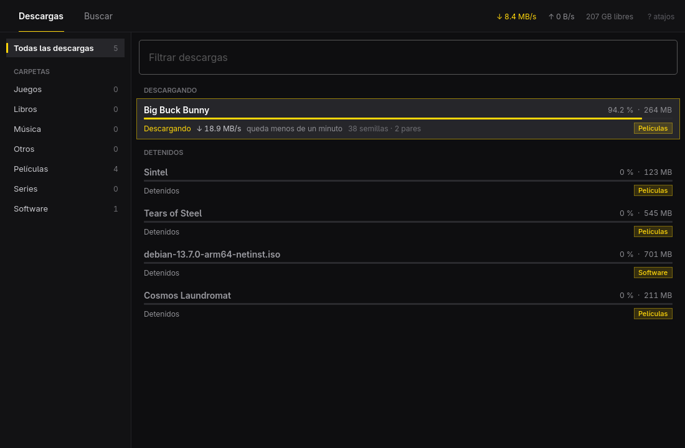

<p align="center"></p>

# Torrente

Download, find and sort torrents — an app for [Omarchy](https://omarchy.org), built the way Omarchy's own apps are: one window, driven from the keyboard or the mouse, in the desktop's font, colors and language, following them live.



- **Magnets, files and links.** Paste a magnet link with Ctrl+V, drop a `.torrent` on the window, or click a magnet link in the browser.
- **Search.** Search the web through qBittorrent's own search plugins; you pick which sites to use.
- **Sorted for you.** Each download lands in a folder by type — Movies, Series, Music, Books, Software, Games, Other — once it finishes. Unfinished downloads wait in a hidden folder.
- **Tagged for you.** Quality, format and language come from the release name: `4K`, `1080p`, `HDR`, `HEVC`, `BluRay`, `WEB`, `FLAC`, `ES`, `LAT`, `VOSE`, `MULTI`…
- **Ordered for you.** What needs attention comes first, then what's downloading, waiting, stopped, and done.
- **Mouse or keyboard.** Every download has Stop/Resume and Remove buttons, and a right-click menu with the rest: open the folder, change the category, edit the tags. Every shortcut below has a mouse way too.
- **Keeps going when closed.** Torrente drives [qbittorrent-nox](https://github.com/qbittorrent/qBittorrent) through its Web API. The engine runs as a user service, so downloads continue with the window closed — and qBittorrent's Web UI (or VueTorrent) still works alongside.
- **Sorts even with the window closed.** `torrente daemon` runs beside the engine as a user service. It files and tags whatever gets added, whether from the browser, the bar, or the command line, and posts a desktop notification when a download finishes. Clicking the notification opens the folder.
- **Lives on the Omarchy bar.** The bar plugin shows the download speed while something is downloading. Its panel lists what is downloading and what finished today: pause or resume a download, cancel it or take it off the list (the bin asks for a second click; cancelling deletes what was downloaded, removing a finished one keeps its files), open its folder, paste a magnet link from the clipboard (`P`), or open Torrente (`O`). Middle-click the icon to paste a magnet; right-click it to open Torrente.

## Install

```sh
git clone https://github.com/nadalbatle/torrente
cd torrente
bin/install
systemctl --user enable --now torrente-engine.service
torrente plugin install          # optional: put Torrente on the Omarchy bar
```

Starting the engine also starts the daemon (`torrente-daemon.service`), and stopping the engine stops the daemon too. After upgrading from 0.1, restart the engine once with `systemctl --user restart torrente-engine.service`.

`bin/install` builds an Arch package with `makepkg` and installs it, so Torrente appears in the app launcher (`Super + Space`). The window offers to start the engine if it isn't running.

Torrente reaches the engine at `http://127.0.0.1:8080` without a password. If qBittorrent's Web UI is set up differently, enable **Bypass authentication for clients on localhost**, or point Torrente elsewhere with `TORRENTE_ENGINE_URL`.

## Languages

Torrente follows the language picked in Omarchy (Setup > Language), live, in English, Spanish, Catalan, French, German, Italian, Portuguese (Portugal and Brazil), Dutch, Swedish, Polish, Russian, Ukrainian, Japanese, Korean, Chinese (Simplified and Traditional) and Arabic, which mirrors the window right to left. The bar plugin and the launcher entry are translated too. Other languages fall back to English; a translation is one JSON file in `src/i18n/` and one in `plugin/i18n/`.

Folders are named in the language of the day Torrente first sets them up, and keep that name afterwards, so switching languages never moves your files.

## Security

Torrente talks to the engine on `127.0.0.1` without a password, so the engine must not answer to any other host name. Otherwise a web page could reach it through DNS rebinding, and the engine can install and run search plugins. When the engine listens only on this computer and lets localhost in without a password, Torrente limits the engine's server domains to `127.0.0.1;localhost;[::1]` the first time it connects. Torrent names, search results and engine messages are shown as plain text everywhere. Links from search plugins are followed only when they are magnet or web links.

## Shortcuts

| Key | Action |
| --- | --- |
| `1` / `2` | Downloads / Search |
| `Ctrl+V` | Add the magnet link on the clipboard |
| `A` | Add `.torrent` files |
| `/` | Filter downloads, or type a search |
| `↑` `↓` / `j` `k` | Move through the list |
| `[` `]` | Previous / next folder or tag |
| `Space` | Stop or resume; download a search result |
| `Enter` | Open the folder; download a search result |
| `C` | Change the category |
| `T` | Edit the tags |
| `R` | Sort and tag again |
| `Delete` | Remove the download |
| `O` | Open a result's web page |
| `E` | Search engines |
| `,` | Settings |
| `Esc` | Close, clear the filter, or stop the search |
| `?` | All shortcuts |
| `Q` | Quit (downloads keep going) |

## Command line

```sh
torrente add 'magnet:?xt=…'     # add without opening the window
torrente list --json            # what the engine is doing
torrente plugin install         # add the bar plugin (copies it to ~/.config/omarchy/plugins/torrente.panel)
torrente plugin remove          # take it off the bar
torrente daemon                 # what torrente-daemon.service runs
```

## Development

```sh
bin/build    # qmake6 + make into build/torrente
bin/test     # unit tests, offscreen
bin/install  # package and install
```

C++ and Qt Quick, no CMake. The logic lives in `src/` (`backend`, `classifier`, `torrentmodel`, `qbtclient`); the window is `src/Main.qml`. Translations are JSON catalogs in `src/i18n/`.

The bar plugin is in `plugin/`: a `Panel.qml`, the engine logic in `Model.js` (tested with `node plugin/tests/Model.test.js`), and its own catalogs in `plugin/i18n/`. To work on it live, link it into the shell's plugin folder with `ln -s "$PWD/plugin" ~/.config/omarchy/plugins/torrente.panel`. It talks only to the engine on `127.0.0.1`, and shows everything the engine sends as plain text.

## License

MIT. Theme, language and portal code follow Omacut and Monologue by David Heinemeier Hansson (MIT). Search plugins come from qBittorrent and are installed only when you choose them; use Torrente for content you have the right to share.
